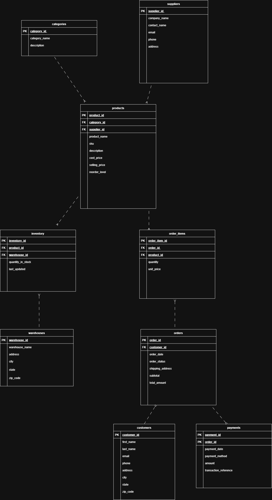

# 📦 StockFlow Inventory Management System

A professional PostgreSQL database project that simulates a real-world inventory management system. The project demonstrates relational database design, SQL development, stored functions, triggers, views, indexing, and query optimization.

---

## Table of Contents

- [Overview](#overview)
- [Features](#features)
- [Database Schema](#database-schema)
- [ER Diagram](#er-diagram)
- [Database Objects](#database-objects)
  - [Tables](#tables)
  - [Views](#views)
  - [Functions](#functions)
  - [Triggers](#triggers)
  - [Indexes](#indexes)
- [Example Queries](#example-queries)
- [How to Run](#how-to-run)
- [Project Structure](#project-structure)
- [Future Improvements](#future-improvements)
- [Author](#author)
- [License](#license)

---

# Overview

The **StockFlow Inventory Management System** is a PostgreSQL database project designed to manage products, suppliers, warehouses, inventory, customers, orders, and payments.

The project follows database normalization principles and demonstrates the use of:

- Relational database design
- Primary and foreign keys
- Constraints
- Views
- Stored Functions
- Triggers
- Indexes
- Query optimization

This project was built as part of my software development portfolio to demonstrate practical SQL and PostgreSQL skills for backend development.

---

# Features

- Product Management
- Category Management
- Supplier Management
- Warehouse Management
- Inventory Tracking
- Customer Management
- Order Processing
- Payment Processing
- Inventory Reports
- Low Stock Monitoring
- Automatic Inventory Updates
- Stored Functions
- Query Optimization with Indexes

---

# Database Schema

The database contains **9 relational tables**.

| Table | Description |
|--------|-------------|
| categories | Stores product categories |
| suppliers | Stores supplier information |
| products | Stores product details |
| warehouses | Stores warehouse locations |
| inventory | Tracks inventory quantities |
| customers | Stores customer information |
| orders | Stores customer orders |
| order_items | Stores products within each order |
| payments | Stores payment records |

---

# ER Diagram



---

# Database Objects

## Tables

- categories
- suppliers
- products
- warehouses
- inventory
- customers
- orders
- order_items
- payments

---

## Views

The project contains four reporting views:

- product_details_view
- inventory_report_view
- order_details_view
- low_stock_view

---

## Functions

### calculate_inventory_value()

Calculates the total inventory value across all warehouses.

Example:

```sql
SELECT calculate_inventory_value();
```

---

## Triggers

The project includes triggers that automatically maintain inventory consistency whenever order records are created or modified.

---

## Indexes

Indexes have been created to improve database performance on frequently searched columns and foreign key relationships.

Indexed tables include:

- products
- inventory
- orders
- order_items
- payments

---

# Example Queries

## View Products

```sql
SELECT * FROM products;
```

## Inventory Report

```sql
SELECT * FROM inventory_report_view;
```

## Order Details

```sql
SELECT * FROM order_details_view;
```

## Low Stock Report

```sql
SELECT * FROM low_stock_view;
```

## Calculate Inventory Value

```sql
SELECT calculate_inventory_value();
```

---

# How to Run

### 1. Install PostgreSQL

Install PostgreSQL and pgAdmin.

### 2. Create a Database

```sql
CREATE DATABASE stockflow_db;
```

### 3. Open Query Tool

Connect to **stockflow_db**.

### 4. Execute the SQL Script

Run:

```
stockflow_database.sql
```

This will automatically create:

- Tables
- Constraints
- Relationships
- Views
- Functions
- Triggers
- Indexes
- Sample Data

### 5. Run Example Queries

Test the database using the example queries above.

---

# Project Structure

```
StockFlow-Inventory-System/
│
├── README.md
├── LICENSE
├── stockflow_database.sql
│
├── screenshots/
│   ├── erd.png
│   ├── tables.png
│   ├── views.png
│   ├── indexes.png
│   ├── inventory_report.png
│   ├── low_stock.png
│   ├── order_details.png
│   └── inventory_value.png
│
└── docs/
    └── project_description.pdf
```

---

# Future Improvements

Potential future enhancements include:

- User authentication
- Role-based access control
- Purchase order management
- Sales analytics
- Supplier analytics
- Barcode integration
- REST API using Node.js
- Docker deployment
- Cloud database deployment
- Web dashboard

---

# Author

**Hussein Almoadhen**

Applied Computing Student

Aspiring Backend Software Developer

GitHub:
https://github.com/husseinalmoadhen

LinkedIn:
https://www.linkedin.com/in/hussein-almoadhen/

---

# License

This project is licensed under the **MIT License**.

See the **LICENSE** file for details.